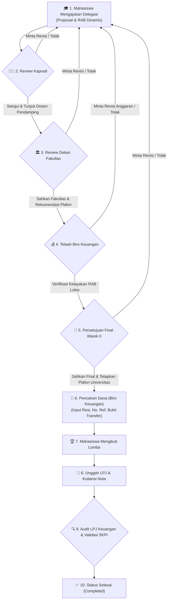

# 🏆 SIPRES UNUJA — Sistem Informasi Pengajuan Lomba & Prestasi Mahasiswa

<p align="center">
  
  
  
  
  
</p>

---

## 📌 Tentang Aplikasi

**SIPRES UNUJA** adalah aplikasi berbasis web yang dikembangkan oleh **Pusat Data & Sistem Informasi (PDSI) Universitas Nurul Jadid (UNUJA)** untuk mengelola seluruh siklus delegasi kompetisi dan prestasi mahasiswa secara terpusat, transparan, dan otomatis.

Sistem ini memfasilitasi birokrasi berjenjang mulai dari pengajuan proposal delegasi, penunjukan dosen pendamping oleh Kaprodi, persetujuan fakultas & rekomendasi plafon oleh Dekan, telaah administrasi anggaran oleh Biro Keuangan, penetapan dana definitif tingkat universitas oleh Wakil Rektor II, pencairan dana, hingga audit kuitansi LPJ dan klaim perolehan **Poin SKPI (Surat Keterangan Pendamping Ijazah)**.

---

## 🔄 Alur Kerja Sistem (4-Step Sequential Approval Workflow)



> **🛡️ Proteksi Otomatis Tunggakan LPJ:** Mahasiswa yang belum menyelesaikan kewajiban LPJ untuk lomba yang telah lewat tanggalnya akan otomatis diblokir dari mengajukan delegasi baru hingga LPJ disetujui.

---

## ✨ Fitur Unggulan Berdasarkan Peran (6 Role Lengkap)

### 1. 🎓 Portal Mahasiswa
* **Dashboard Mandiri:** Statistik pengajuan aktif, riwayat lomba, dan status akun *(Bebas Tunggakan / Tercekal LPJ)*.
* **Formulir Pengajuan Modern (2 Kolom):**
  * Input informasi kompetisi lengkap *(Nama, tingkat, kategori, tautan resmi, tanggal, lokasi)*.
  * Penyusunan tim delegasi otomatis berdasarkan NIM ketua & anggota.
  * Unggah dokumen proposal resmi (format PDF dengan batas maks. 10 MB).
  * Tabel Rincian Anggaran Biaya (RAB) dinamis dengan kalkulasi subtotal dan total otomatis.
  * Indikator bilah progres pengisian formulir secara *real-time* (0% – 100%).
* **Tracking & Dokumen:** Pantau alur verifikasi berkas dan unduh **Surat Dispensasi Kuliah** serta **Surat Tugas** resmi.
* **Laporan Pasca-Lomba:** Unggah dokumen LPJ, kuitansi/nota belanja, foto kegiatan, serta klaim perolehan Poin SKPI & insentif juara.

### 2. 👨‍🏫 Portal Kaprodi (Ketua Program Studi)
* **Ringkasan Statistik 4 Metrik:** *Total Pengajuan*, *Menunggu Verifikasi*, *Sudah Ditunjuk Dosen*, dan *Selesai Review*.
* **Penunjukan Dosen Pendamping:** Kaprodi memiliki wewenang resmi untuk memilih dan menetapkan dosen pendamping (lengkap dengan NIDN) untuk setiap tim delegasi.
* **Verifikasi Proposal:** Menelaah proposal kegiatan dan rincian usulan anggaran sebelum diteruskan ke pimpinan fakultas.

### 3. 🏛️ Portal Dekan (Pimpinan Fakultas)
* **Dashboard Eksekutif Fakultas:** Identitas visual modern bernuansa aksen ungu dengan ringkasan *Antrean Proposal*, *Antrean LPJ & SKPI*, *Lomba Aktif*, dan *Prestasi Selesai*.
* **Persetujuan Fakultas & Rekomendasi Plafon:** Tombol aksi *"Proses & Sahkan Final"* untuk mengesahkan delegasi lomba dan merekomendasikan batas plafon dana fakultas.
* **Validasi LPJ & SKPI:** Memeriksa laporan pertanggungjawaban kegiatan mahasiswa fakultas.
* **Rekapitulasi Prestasi Mahasiswa (Print-Ready):** Laporan capaian delegasi fakultas yang dilengkapi dengan **Kop Resmi UNUJA** dan lembar tanda tangan Dekan saat dicetak (`window.print()`).

### 4. 💰 Portal Keuangan (Biro Keuangan UNUJA)
* **Identitas Warna:** Biru tua, biru muda, putih, dengan aksen hijau realisasi kas dan aksen oranye verifikasi.
* **4 Kartu Statistik Keuangan:** *Menunggu Verifikasi Anggaran*, *Menunggu Persetujuan Warek II*, *Menunggu Pencairan Dana*, dan *Total Dana Telah Dicairkan*.
* **Antrean Verifikasi Anggaran:** Telaah kelayakan item RAB, batas pagu fakultas, perbaikan nota anggaran, dan penerusan berkas ke Warek II.
* **Modul Pencairan Dana (Disbursement):** Form modal pencairan dana dengan input nominal, tanggal transfer, nomor referensi bank, upload file bukti transfer/resi transfer, dan catatan pencairan.
* **Audit LPJ & Kuitansi:** Pemeriksaan bukti transaksi, kuitansi riil belanja lomba, dan sisa pengembalian kas jika ada.
* **Laporan Realisasi Anggaran:** Format tabel rekapitulasi serapan pagu per fakultas, filter tahun/fakultas/status, dan print-ready view.

### 5. 👑 Portal Wakil Rektor II (Warek II — Administrasi Umum & Keuangan)
* **Identitas Visual:** Ungu Eksekutif (`#7E22CE` / deep indigo), putih, dan abu-abu netral.
* **4 Kartu Statistik Eksekutif:** *Menunggu Persetujuan Final*, *Total Anggaran Disetujui Universitas*, *Total Dana Dicairkan*, dan *Total Prestasi Universitas*.
* **Persetujuan Final Tingkat Universitas:** Wewenang definitif penetapan besaran plafon bantuan universitas, disposisi revisi, atau penolakan.
* **Monitoring Anggaran Fakultas:** Visualisasi alokasi pagu vs realisasi serapan dana lomba antar-fakultas (FTI, FAI, FEB, FKES).
* **Monitoring Prestasi Universitas:** Pangkalan data seluruh delegasi juara dan perolehan medali mahasiswa tingkat universitas dengan filter tingkat kompetisi.

### 6. 🛡️ Portal Administrator (Super Observer) & Quick Demo Switcher
* Akses monitoring menyeluruh seluruh pengajuan lomba lintas program studi dan fakultas dalam mode read-only observer.
* **Fitur Demo Role Switcher:** Menu dropdown *"Ganti Role (Demo)"* di header untuk berpindah 6 peran secara instan *(Mahasiswa, Kaprodi, Dekan, Keuangan, Warek II, Admin)* tanpa perlu login ulang.

---

## 🗄️ Arsitektur Multi-Database

SIPRES UNUJA dirancang dengan arsitektur multi-database untuk modularitas dan kesiapan microservices:

| Nama Database | Peran & Isi Data |
| :--- | :--- |
| **`sipres_identity`** | Autentikasi pengguna, role-based access, academic profiles, dan audit log jejak audit. |
| **`sipres_submission`** | Data utama pengajuan lomba, berkas proposal, susunan anggota, LPJ, dan sertifikat prestasi. |
| **`sipres_workflow`** | Mesin *state-machine* alur persetujuan bertingkat (*Approval Flow & Steps: Kaprodi -> Dekan -> Keuangan -> Warek II*) serta audit logs. |
| **`sipres_finance`** | Data pengajuan RAB, penetapan plafon dana bantuan lomba, tiket pencairan transfer, dan insentif juara. |

---

## 🚀 Panduan Instalasi (Quick Start)

Ikuti langkah-langkah mudah berikut untuk menjalankan proyek di komputer lokal Anda:

### 1. Kebutuhan Sistem
* PHP `>= 8.4` (Ekstensi: `pdo_mysql`, `mbstring`, `openssl`, `curl`)
* Composer `>= 2.x`
* Node.js `>= 18.x` & NPM
* Web Server (Laragon / XAMPP / Native FrankenPHP)
* MySQL Database Server

### 2. Kloning Repositori
```bash
git clone https://github.com/justsanzz07/tugas-micro-.git
cd tugas-micro-
```

### 3. Instal Dependensi
```bash
# Instal dependensi PHP
composer install

# Instal dependensi Frontend
npm install
```

### 4. Konfigurasi Lingkungan (`.env`)
Salin file konfigurasi lingkungan:
```bash
cp .env.example .env
php artisan key:generate
```

Pastikan pengaturan database pada `.env` sudah sesuai:
```env
DB_CONNECTION=mysql
DB_HOST=127.0.0.1
DB_PORT=3306
DB_DATABASE=sipres_identity
DB_USERNAME=root
DB_PASSWORD=

DB_SUBMISSION_DATABASE=sipres_submission
DB_WORKFLOW_DATABASE=sipres_workflow
DB_FINANCE_DATABASE=sipres_finance
```

### 5. Migrasi & Seeder Database
Jalankan migrasi database serta seeder pengguna:
```bash
# Menjalankan seeder pengguna & profil akademik (6 Role lengkap)
php artisan db:seed
```

### 6. Kompilasi Aset & Jalankan Server
```bash
# Jalankan web server Laravel
php artisan serve
```

Buka peramban (browser) dan akses: **`http://127.0.0.1:8000`**

---

## 🔑 Akun Uji Coba (Demo Login 6 Peran)

Anda dapat masuk menggunakan akun uji coba di bawah ini atau memanfaatkan menu **Ganti Role (Demo)** di pojok kanan atas:

| Role / Peran | Email / Identitas | Password | Keterangan |
| :--- | :--- | :--- | :--- |
| **Mahasiswa** | `mahasiswa@unuja.ac.id` *(NIM: 242140001)* | `password` | Mahasiswa Aktif Fakultas Teknik (FTI) |
| **Kaprodi** | `iqbal@unuja.ac.id` *(NIDN: 0720048502)* | `password` | Ketua Program Studi Informatika |
| **Dekan** | `faisol@unuja.ac.id` *(NIDN: 0715017803)* | `password` | Dekan Fakultas Teknologi Informasi |
| **Keuangan** | `keuangan@unuja.ac.id` *(ID: KEU-01)* | `password` | Biro Keuangan & Administrasi Anggaran |
| **Warek II** | `warek2@unuja.ac.id` *(NIDN: 0701017503)* | `password` | Wakil Rektor II (Umum & Keuangan) |
| **Admin** | `admin.sipres@unuja.ac.id` | `password` | Administrator Sistem (Super Observer) |

> **💡 Pintasan Cepat:** Anda juga dapat mengakses langsung URL demo login berikut saat server aktif:  
> - Mahasiswa: `http://127.0.0.1:8000/demo-login/mahasiswa`  
> - Kaprodi: `http://127.0.0.1:8000/demo-login/kaprodi`  
> - Dekan: `http://127.0.0.1:8000/demo-login/dekan`  
> - Keuangan: `http://127.0.0.1:8000/demo-login/keuangan`  
> - Warek II: `http://127.0.0.1:8000/demo-login/warek2`  
> - Admin: `http://127.0.0.1:8000/demo-login/admin`

---

## 🧪 Pengujian Otomatis (Testing)

Aplikasi telah dilengkapi dengan pengujian fitur end-to-end (PHPUnit) yang mencakup seluruh role (Mahasiswa, Kaprodi, Dekan, Keuangan, Warek II, Admin), middleware otorisasi, dan siklus hidup persetujuan:

```bash
# Menjalankan seluruh rangkaian tes otomatis
php artisan test --compact
```
*(Seluruh **32 tes otomatis** terverifikasi 100% lulus / Passed).*

---

## 🏛️ Pengembang

Dikembangkan untuk **Universitas Nurul Jadid (UNUJA)**  
Pusat Data & Sistem Informasi (PDSI)  
Karanganyar, Paiton, Probolinggo, Jawa Timur.
