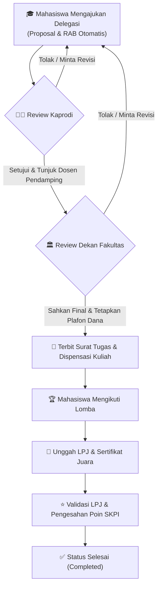

# 🏆 SIPRES UNUJA — Sistem Informasi Pengajuan Lomba & Prestasi Mahasiswa

<p align="center">
  
  
  
  
  
</p>

---

## 📌 Tentang Aplikasi

**SIPRES UNUJA** adalah aplikasi berbasis web yang dikembangkan oleh **Pusat Data & Sistem Informasi (PDSI) Universitas Nurul Jadid (UNUJA)** untuk mengelola seluruh siklus delegasi kompetisi dan prestasi mahasiswa secara terpusat, transparan, dan otomatis.

Sistem ini memfasilitasi birokrasi berjenjang mulai dari pengajuan proposal delegasi, penunjukan dosen pendamping oleh Kaprodi, persetujuan bantuan dana & surat tugas oleh Dekan Fakultas, hingga pelaporan LPJ pasca-lomba dan klaim perolehan **Poin SKPI (Surat Keterangan Pendamping Ijazah)**.

---

## 🔄 Alur Kerja Sistem (Workflow)



> **🛡️ Proteksi Otomatis Tunggakan LPJ:** Mahasiswa yang belum menyelesaikan kewajiban LPJ untuk lomba yang telah lewat tanggalnya akan otomatis diblokir dari mengajukan delegasi baru hingga LPJ disetujui.

---

## ✨ Fitur Unggulan Berdasarkan Peran (Role)

### 1. 🎓 Portal Mahasiswa
* **Dashboard Mandiri:** Statistik pengajuan aktif, riwayat lomba, dan status akun *(Bebas Tunggakan / Tercekal LPJ)*.
* **Formulir Pengajuan Modern (2 Kolom):**
  * Input informasi kompetisi lengkap *(Nama, tingkat, kategori, tautan resmi, tanggal, lokasi)*.
  * Penyusunan tim delegasi otomatis berdasarkan NIM ketua & anggota.
  * Unggah dokumen proposal resmi (format PDF dengan batas maks. 10 MB).
  * Tabel Rincian Anggaran Biaya (RAB) dinamis dengan kalkulasi subtotal dan total otomatis.
  * Indikator bilah progres pengisian formulir secara *real-time* (0% – 100%).
* **Tracking & Dokumen:** Pantau alur verifikasi berkas dan unduh **Surat Dispensasi Kuliah** serta **Surat Tugas** resmi.
* **Laporan Pasca-Lomba:** Unggah dokumen LPJ, kuitansi/nota belanja, foto kegiatan, serta klaim perolehan Poin SKPI & insentif juara.

### 2. 👨‍🏫 Portal Kaprodi (Ketua Program Studi)
* **Ringkasan Statistik 4 Metrik:** *Total Pengajuan*, *Menunggu Verifikasi*, *Sudah Ditunjuk Dosen*, dan *Selesai Review*.
* **Penunjukan Dosen Pendamping:** Kaprodi memiliki wewenang resmi untuk memilih dan menetapkan dosen pendamping (lengkap dengan NIDN) untuk setiap tim delegasi.
* **Verifikasi Proposal:** Menelaah proposal kegiatan dan rincian usulan anggaran sebelum diteruskan ke pimpinan fakultas.
* **Pencarian & Filter Cepat:** Temukan pengajuan berdasarkan kode, nama lomba, atau nama ketua tim dengan dukungan server-side pagination.

### 3. 🏛️ Portal Dekan (Pimpinan Fakultas)
* **Dashboard Eksekutif Fakultas:** Identitas visual modern bernuansa aksen ungu dengan ringkasan *Antrean Proposal*, *Antrean LPJ & SKPI*, *Lomba Aktif*, dan *Prestasi Selesai*.
* **Persetujuan Final & Pagu Dana:** Tombol aksi *"Proses & Sahkan Final"* untuk mengesahkan delegasi lomba dan menetapkan besaran dana bantuan fakultas.
* **Validasi LPJ & SKPI:** Memeriksa laporan pertanggungjawaban dana dan mengesahkan perolehan poin SKPI mahasiswa berprestasi.
* **Rekapitulasi Prestasi Mahasiswa (Print-Ready):** Laporan capaian delegasi fakultas yang dilengkapi dengan **Kop Resmi UNUJA** dan lembar tanda tangan Dekan saat dicetak (`window.print()`).

### 4. 🛡️ Portal Admin & Quick Role Switcher
* Akses monitoring menyeluruh seluruh pengajuan lomba lintas program studi dan fakultas.
* **Fitur Demo Role Switcher:** Menu dropdown *"Ganti Role (Demo)"* di header untuk berpindah peran secara instan *(Mahasiswa, Kaprodi, Dekan, Admin)* saat presentasi atau pengujian tanpa perlu login ulang.

---

## 🗄️ Arsitektur Multi-Database

SIPRES UNUJA dirancang dengan arsitektur multi-database untuk modularitas dan kesiapan microservices:

| Nama Database | Peran & Isi Data |
| :--- | :--- |
| **`sipres_identity`** | Autentikasi pengguna, role-based access, dan profil kependudukan kampus. |
| **`sipres_submission`** | Data utama pengajuan lomba, berkas proposal, susunan anggota, LPJ, dan sertifikat prestasi. |
| **`sipres_workflow`** | Mesin *state-machine* alur persetujuan bertingkat (*Approval Flow & Steps*) serta audit logs. |
| **`sipres_finance`** | Data pengajuan RAB, penetapan plafon dana bantuan lomba, dan insentif juara. |

---

## 🚀 Panduan Instalasi (Quick Start)

Ikuti langkah-langkah mudah berikut untuk menjalankan proyek di komputer lokal Anda:

### 1. Kebutuhan Sistem
* PHP `>= 8.4` (Ekstensi: `pdo_mysql`, `mbstring`, `openssl`, `curl`)
* Composer `>= 2.x`
* Node.js `>= 18.x` & NPM
* Web Server (Laragon / XAMPP / Native FrankenPHP)
* MySQL Database Server

### 2. Kloning Repositori
```bash
git clone https://github.com/justsanzz07/tugas-micro-.git
cd tugas-micro-
```

### 3. Instal Dependensi
```bash
# Instal dependensi PHP
composer install

# Instal dependensi Frontend
npm install
```

### 4. Konfigurasi Lingkungan (`.env`)
Salin file konfigurasi lingkungan:
```bash
cp .env.example .env
php artisan key:generate
```

Pastikan pengaturan database pada `.env` sudah sesuai (secara bawaan menggunakan MySQL `localhost:3306`, user `root`, tanpa password):
```env
DB_CONNECTION=mysql
DB_HOST=127.0.0.1
DB_PORT=3306
DB_DATABASE=sipres_identity
DB_USERNAME=root
DB_PASSWORD=

DB_SUBMISSION_DATABASE=sipres_submission
DB_WORKFLOW_DATABASE=sipres_workflow
DB_FINANCE_DATABASE=sipres_finance
```

### 5. Migrasi & Seeder Database
Jalankan migrasi multi-database khusus SIPRES serta isi data dummy:
```bash
# Menjalankan migrasi seluruh tabel modul
php artisan sipres:migrate

# Mengisi data dummy pengguna dan pengajuan
php artisan db:seed
```

### 6. Kompilasi Aset & Jalankan Server
```bash
# Di terminal 1: Kompilasi frontend
npm run dev

# Di terminal 2: Jalankan web server Laravel
php artisan serve
```

Buka peramban (browser) dan akses: **`http://127.0.0.1:8000`**

---

## 🔑 Akun Uji Coba (Demo Login)

Anda dapat masuk menggunakan akun uji coba di bawah ini atau memanfaatkan menu **Ganti Role (Demo)** di pojok kanan atas:

| Role / Peran | Email / Identitas | Password | Keterangan |
| :--- | :--- | :--- | :--- |
| **Mahasiswa** | `mahasiswa@unuja.ac.id` *(NIM: 2022010001)* | `password` | Mahasiswa Aktif Fakultas Teknik |
| **Kaprodi** | `dosen@unuja.ac.id` *(NIDN: 0715088901)* | `password` | Ketua Program Studi Informatika |
| **Dekan** | `dekan@unuja.ac.id` *(NIDN: 0720048102)* | `password` | Dekan Fakultas Teknologi Informasi |
| **Admin** | `admin@unuja.ac.id` | `password` | Administrator Sistem |

> **💡 Pintasan Cepat:** Anda juga dapat mengakses langsung URL berikut saat server aktif:  
> - Mahasiswa: `http://127.0.0.1:8000/demo-login/mahasiswa`  
> - Kaprodi: `http://127.0.0.1:8000/demo-login/kaprodi`  
> - Dekan: `http://127.0.0.1:8000/demo-login/dekan`  
> - Admin: `http://127.0.0.1:8000/demo-login/admin`

---

## 🧪 Pengujian Otomatis (Testing)

Aplikasi telah dilengkapi dengan pengujian fitur end-to-end (PHPUnit) yang mencakup navigasi mahasiswa, dashboard Kaprodi, dashboard Dekan, serta siklus hidup pengajuan proposal:

```bash
# Menjalankan seluruh rangkaian tes otomatis
php artisan test --compact
```
*(Seluruh 23 tes otomatis terverifikasi 100% lulus).*

---

## 🏛️ Pengembang

Dikembangkan untuk **Universitas Nurul Jadid (UNUJA)**  
Pusat Data & Sistem Informasi (PDSI)  
Karanganyar, Paiton, Probolinggo, Jawa Timur.
